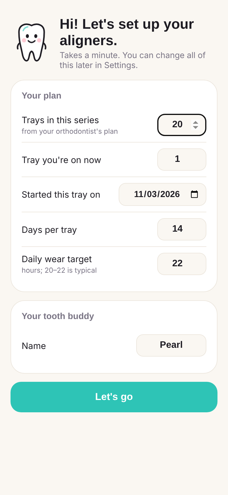
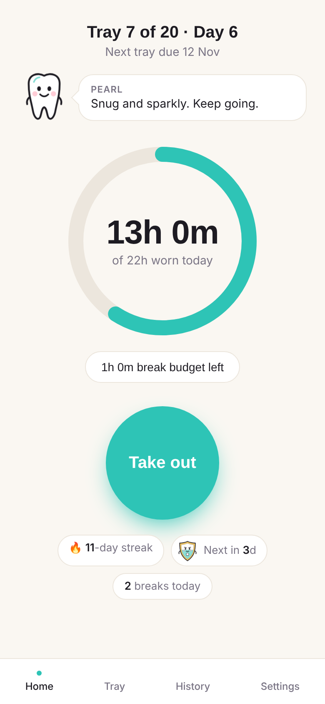
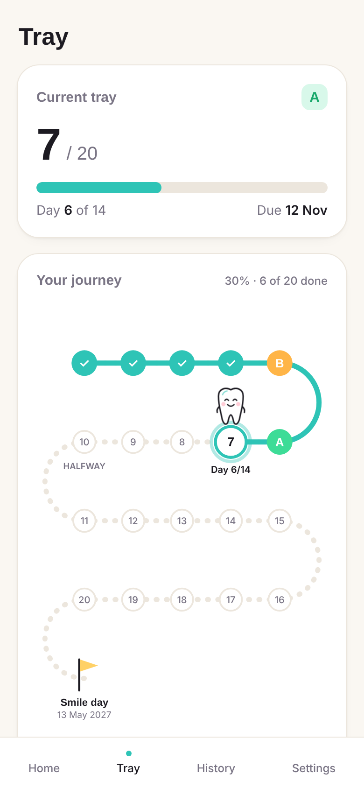
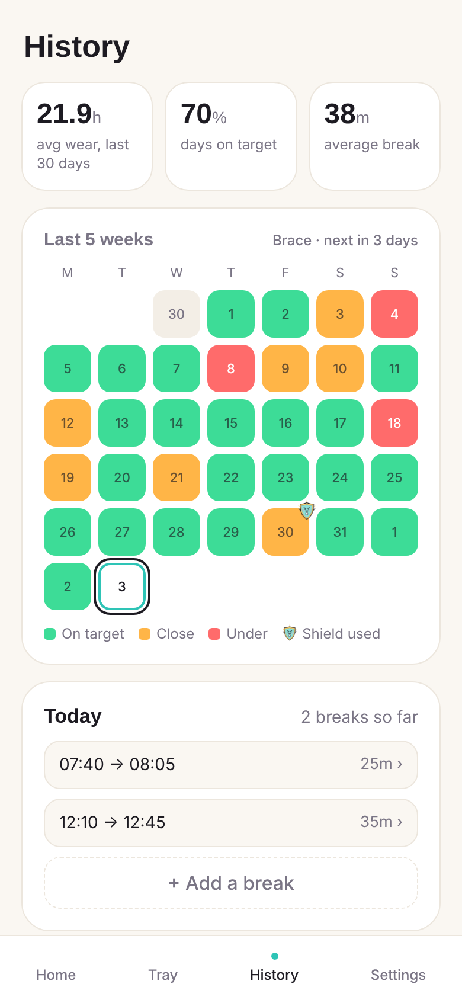
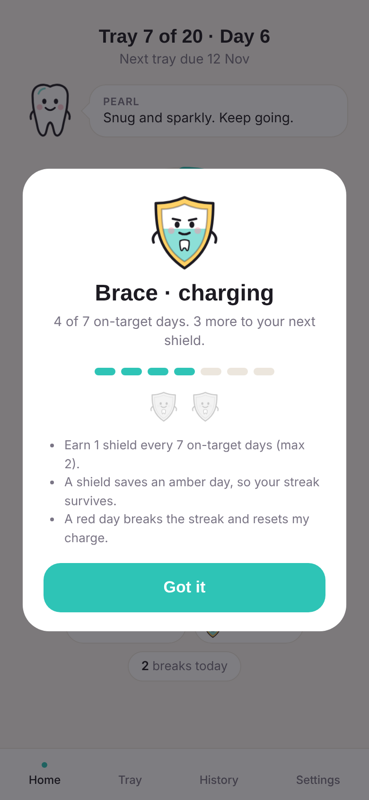

# Aligner Tracker 

A free, phone-first tracker for clear aligners (Invisalign and similar). Log every break with one tap, see your daily wear time fill up like a fitness ring, get nudged when your aligners have been out too long, and never miss a tray change.

It runs entirely on **your own Google account**: a Google Sheet is the database, Google Apps Script is the backend, and the app is a web page you add to your home screen. No subscriptions, no servers, no app store.

<p>
  
  
  
  
  
</p>

## Features

| Area | What it does |
|---|---|
| **One-tap logging** | A big Take out / Put back in button. Wear time = 24h minus time out, so you only log breaks. |
| **Daily ring + break budget** | Fills toward your target (default 22h). Shows how much break time you have left today. Confetti when it closes. |
| **Trays** | Tray X of N, day Y of 14, due date, and a one-tap *Start next tray*, which adds a Google Calendar reminder for the next due date. |
| **Reminders** *(optional, via Telegram)* | Out-too-long nudge (default 45 min), tray-change-day message (9 AM), nightly check-in (default 10 PM). |
| **History** | 5-week heatmap, 30-day stats, per-tray grades (A/B/C), personal bests, and editing of any break. |
| **Gamification** | Streaks with shields (earn one per 7 on-target days; it saves an "almost" day), tray level-ups, and a journey map from tray 1 to *Smile day*. |
| **Pearl** | A tooth mascot with moods (happy, snacking, worried, sleepy, celebrating) and a speech bubble. Rename her in Settings. |
| **Brace** | Pearl's shield buddy. He fills up as you earn your next shield (meter on Home; tap for details), steps in with a *Blocked!* moment when a shield saves your streak, and marks saved days on the heatmap. |
| **Your data** | Everything lives in your Google Sheet. Export it anytime with File → Download. |

## What you need

- A Google account (free)
- A phone browser (Safari on iPhone, Chrome on Android)
- *Optional:* Telegram, for reminder messages

Nothing in the code is specific to any one person. Your treatment plan is entered on the app's first-run screen and stored in your own Sheet.

## Setup (about 10 minutes)

1. **Create a Google Sheet.** Go to [sheets.new](https://sheets.new) and name it e.g. *Aligner Tracker*.
   Check **File → Settings → Time zone** is your time zone; all dates follow it.
2. **Open Apps Script.** In the Sheet: **Extensions → Apps Script**.
3. **Add the code.**
   - Replace everything in `Code.gs` with [`src/Code.gs`](src/Code.gs).
   - Click **+ → HTML**, name it exactly **`Index`**, and replace its contents with [`src/Index.html`](src/Index.html).
   - Click 💾 Save.
4. **Run setup.** Pick **`setup`** in the function dropdown, then **Run**. Google will ask for permission. Because this is your own script, you'll see "Google hasn't verified this app": click **Advanced → Go to (project name)** and **Allow**. This creates the tabs in your Sheet.
5. **Deploy.** **Deploy → New deployment → ⚙️ Web app**
   - *Execute as:* **Me**
   - *Who has access:* **Only myself**
   - **Deploy**, then copy the **Web app URL** (it ends in `/exec`).
6. **Open it on your phone** and fill in the setup screen: trays in your series, the tray you're on, when you started it, days per tray, and target hours.
7. **Add to home screen.**
   - iPhone: Safari → Share → **Add to Home Screen**
   - Android: Chrome → ⋮ → **Add to Home screen**

That's it. The 15-minute background checks for reminders are switched on separately (see below).

### Optional: Telegram reminders

| # | Step |
|---|---|
| 1 | In Telegram, message **@BotFather**, send `/newbot`, and follow the prompts. Copy the **token** it gives you. |
| 2 | Open your new bot and send it any message (e.g. `hi`). |
| 3 | In Apps Script: **⚙️ Project Settings → Script properties → Add**. Name `TELEGRAM_TOKEN`, value = your token. Save. |
| 4 | Run **`connectTelegram`**. You'll get a "Connected" message. |
| 5 | Run **`testReminders`** (sends one of each), then **`installReminders`** (turns on the 15-minute check). |

Keep the token private; anyone with it can message you as the bot. Run `removeReminders` to switch reminders off. Without Telegram the app still works fully, and tray-change reminders still arrive through Google Calendar.

> Why Telegram and not a push service like ntfy? Some push services block Google's servers, so Apps Script can't reach them ("Address unavailable"). Telegram's API works reliably from Apps Script.

### Optional: try it with demo data

After finishing the setup screen, run **`seedDemoData`** to add about 4 weeks of practice history (two earlier demo trays plus daily breaks), so you can see History, grades and the journey map straight away. Remove it from the app with **Settings → Remove demo data**, or run `clearDemoData`. Your real logs are never touched.

## Updating to a new version

1. Paste the new `Code.gs` / `Index.html` and save.
2. **Deploy → Manage deployments → ✏️ Edit → Version: New version → Deploy.**

Always edit the existing deployment. **Deploy → New deployment** creates a *new URL*, and your home-screen icon would keep opening the old version.

## How it works

| Sheet tab | Holds | Written by |
|---|---|---|
| `Settings` | Targets, reminder timings, total trays, mascot name | First-run screen and the Settings screen (or edit by hand) |
| `Trays` | One row per tray: start, planned days, due, end, average wear | Setup and *Start next tray* |
| `Sessions` | One row per break: out time, in time, minutes | The Out/In button and break editor |
| `DailySummary` | Wear per day and its status (green/amber/red) | Rebuilt automatically; don't type here |
| `Appointments` | Reserved for a future feature | — |

| File | Role |
|---|---|
| `src/Code.gs` | Backend: wear maths (DST-safe, breaks split at midnight), trays, streaks and grades, reminders, Calendar, Telegram |
| `src/Index.html` | The whole app: HTML, CSS and JS in one file, with an offline tap queue and the mascot drawn in SVG |
| `src/appsscript.json` | Manifest. Only needed if you use [clasp](https://github.com/google/clasp); the copy-paste setup doesn't need it |

**Grades:** A = average ≥ target, B = within 1h of target, C = lower. **Day colours:** green = on target, amber = at least `amber_hours`, red = below.

## Privacy

- Your data stays in your Google Sheet and your Google account. The web app is deployed with access set to **Only myself**.
- The only outside service is Telegram, and only if you set it up. Messages contain hours and tray numbers.
- No analytics, no tracking, no third-party storage. The page loads Google Fonts and [canvas-confetti](https://github.com/catdad/canvas-confetti) from public CDNs.

## Troubleshooting

| Problem | Fix |
|---|---|
| App shows an old version | Update via **Manage deployments → Edit → New version**, then make sure your home-screen icon uses that deployment's URL. |
| "Google hasn't verified this app" | Expected for personal scripts: **Advanced → Go to project**. |
| Dates or day boundaries look off | Check **File → Settings → Time zone** in the Sheet. |
| No Telegram messages | Run `connectTelegram` again after messaging your bot. Check **Executions** in Apps Script for errors. |
| A small "created by a Google Apps Script user" banner | Google adds it to all Apps Script web apps; it's harmless. |

## Using clasp (optional, for developers)

```bash
npm i -g @google/clasp && clasp login
clasp clone <scriptId> --rootDir src   # or: clasp create --type sheets --rootDir src
clasp push
```

`.clasp.json` is git-ignored because it contains your script ID.

## Disclaimer

This is a personal habit tracker, not medical advice. Follow your orthodontist's instructions on wear time and tray changes.

## License

[MIT](LICENSE)
